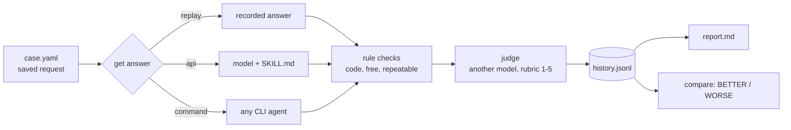

# skill-evals

[](https://github.com/kirmskhq/claude-skill-evals/actions/workflows/tests.yml)


[](LICENSE)

**skill-evals tells you whether an edit to your AI skill made its answers better or worse.**

A skill is a written instruction for a model: a Claude `SKILL.md`, a custom GPT's instructions, a system prompt.
People keep editing them, and any edit can quietly break a rule that used to hold. skill-evals runs the skill on a
few saved example requests, checks each answer against your rules, and keeps a history. A regression then shows up
on the day you make it, before a real user sees a bad answer.

```console
$ skill-evals compare release-notes v2/SKILL.md v3/SKILL.md --mode api --judge
release-notes: WORSE
  checks  before 15/15  after 14/15
  judge   before 5.00  after 5.00
  BROKEN  v3-0-breaking/action_needed
model calls 8, tokens 5096
```

*A real run on Groq (Qwen 3.8 27B runs the skill, GPT-OSS 120B judges it). The v3 edit looked like a harmless
tidy-up. It removed the rule that tells users what to do after a breaking change. The judge gave both versions a
perfect score; the rule check caught it. [Live run](examples/live/groq/) ·
[offline demo](examples/demo/release-notes/), no API key needed.*

## Why

- **Prompts regress silently.** Shortening one rule can break another, and nobody rereads twenty old answers after
  every edit.
- **"It looks better" is not a measurement.** You need the same inputs, the same rules and a number you can compare
  from one version to the next.
- **Most rules are checkable by code.** Word limits, banned phrases, required sections and a closing line don't need
  a model to grade them. Code checks them for free, the same way every time. A judge model handles the rest.

## What you get

| | |
|---|---|
| **Rule checks in YAML** | 12 types: word, paragraph and sentence limits, banned and required phrases, sections in order, first line, language, leftover placeholders. |
| **An LLM judge** | Rubric items scored 1 to 5, with a quote behind every low score. The judge must be a different model from the one that runs the skill. |
| **Before and after** | `compare` runs two versions of a skill on the same cases and prints `BETTER`, `WORSE`, `MIXED` or `SAME`, with each check that was fixed or broken. |
| **History and trend** | Every run is one line in `history.jsonl`. `report` writes a markdown table per skill. `--fail-on-regression` makes CI fail. |
| **Checks that prove themselves** | Each case can save broken answers and name the checks that must catch them. If a check stops catching its defect, the suite fails. |
| **A first draft from your skill** | `init --draft` asks a model to turn the testable rules in `SKILL.md` into checks and a rubric, for you to review. |
| **Any model** | Claude by default (Anthropic API). Also OpenAI, Groq, OpenRouter, Ollama, vLLM, or any CLI agent through `--mode command`. |
| **Guard rails** | A hard cap on model calls and tokens per command. Answers reach the judge marked as untrusted data. Private rules live in a gitignored folder. |

## Quick start

```bash
pip install git+https://github.com/kirmskhq/claude-skill-evals
# or, from a clone: pip install -e ".[dev]"
```

Everything below runs offline on the bundled examples:

```bash
skill-evals --cases examples/cases list        # 5 skills, 7 cases
skill-evals --cases examples/cases defects     # every saved broken answer is caught
skill-evals --cases examples/cases run         # recorded answers through all checks
bash examples/demo/release-notes/run_trend.sh  # three versions of one skill, as a trend report
```

The trend report from that last command ([full report](examples/demo/release-notes/REPORT.md)):

| Label | Skill version | Checks passed |
|---|---|---|
| v1 first draft | b37d2a96 | 11/15 = 73% |
| v2 rules for the reader | e892399c | 15/15 = 100% (+27 pts) |
| v3 tidy-up | ca887adf | 14/15 = 93% (-7 pts) |

> Regressed since the previous run: v3-0-breaking/action_needed

## Use it on your own skill

```bash
skill-evals init my-skill --skill-file ~/.claude/skills/my-skill/SKILL.md   # --draft: let a model propose checks
#   write 3-10 real requests as cases in evals/my-skill/*.yaml, then edit the checks in evals/my-skill/skill.yaml
cp .env.example .env   # add LLM_API_KEY; export the variables in your shell
skill-evals run --mode api --judge --label "baseline"
#   edit SKILL.md, then
skill-evals compare my-skill old/SKILL.md ~/.claude/skills/my-skill/SKILL.md --judge
skill-evals run --mode api --judge --label "shorter intro" --fail-on-regression
skill-evals report
```

A case is one small YAML file:

```yaml
title: A normal release with a fix and an internal change
input: |
  Write release notes for these merged PRs:
  - feat: export reports to CSV (#412)
  - chore: bump eslint to v9 (#416)
checks:
  - id: no_internal_changes
    type: forbidden
    patterns: ['bump', 'dependenc']
defects:
  - file: defects/v2-4.leaks.md
    must_fail: [no_internal_changes]
```

The full format, every check type and how to add your own are in [docs/writing-evals.md](docs/writing-evals.md).

## Models and modes

| Mode | Where answers come from | Good for |
|---|---|---|
| `replay` | recorded answers | CI, checking your checks, demos |
| `api` | `SKILL.md` as the system prompt, the case as the user message | quick runs on any model |
| `command` | any CLI in `SKILL_COMMAND`, with the case on stdin | agents that use tools and reference files |

```bash
LLM_PROVIDER=anthropic   # default; MODEL_SKILL and MODEL_JUDGE default to Claude Sonnet and Opus
LLM_PROVIDER=openai LLM_BASE_URL=https://api.groq.com/openai/v1 MODEL_SKILL=... MODEL_JUDGE=...
```

`api` mode sends only `SKILL.md`. A skill that depends on its reference files or tools gives a fuller answer in
`command` mode, through any agent CLI that reads a prompt on stdin.

## How it works



- Standard library plus `pyyaml`. No provider SDK, no async, about 900 lines of code.
- 44 offline tests, lint and the defect suite run in CI on every push.
- Design decisions and the guesses still to check: [ADR 0001](docs/adr/0001-design.md).

## Examples

- [`examples/skills/release-notes`](examples/skills/release-notes/SKILL.md): a small public skill, with cases in
  [`examples/cases/release-notes`](examples/cases/release-notes/) and the [three-version demo](examples/demo/release-notes/).
- `cover-letter-ru`, `vacancy-evaluation-ru`, `role-profile-ru`, `cv-writing-en`: evals for the author's own
  job-search skills, in Russian and English. Each check quotes the rule it comes from. The skills themselves stay
  private, and the vacancies, companies and answers are invented.

## Status and roadmap

Version 0.1. The checks, history, report, `compare` and `init` are covered by tests. Both model adapters are tested
against a fake network. One live run is published: [release-notes on Groq](examples/live/groq/) (the answers,
the log and the trend report). The answers in `examples/cases` and `examples/demo` are hand-written illustrations.

Next:

- [ ] Several samples per case, with the spread in the report, to catch skills that only work some of the time.
- [ ] A pairwise judge for `compare` ("which answer follows the skill better?"), which is steadier than two separate scores.
- [ ] A GitHub Action that comments the `compare` result on any pull request that changes a `SKILL.md`.
- [ ] Published live runs on Claude (done for open models on Groq).

## Contributing

See [CONTRIBUTING.md](CONTRIBUTING.md). The ideas of a judge on a different model, defect cases and a hard budget
come from the author's earlier [llm-evals-harness](https://github.com/kirmskhq/llm-evals-harness-wip).

MIT License.
